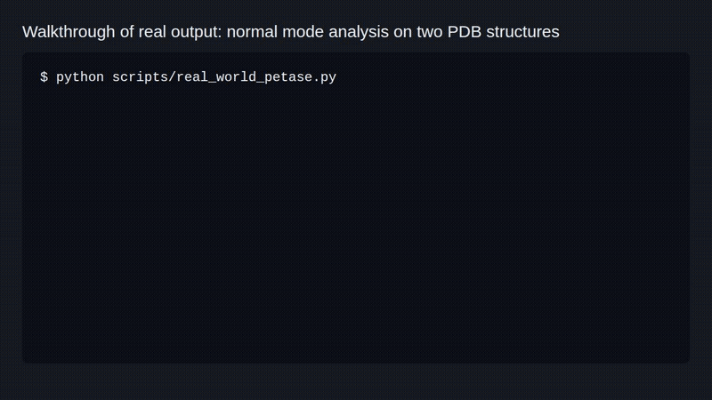

# Quantum Data Decoder



Research code for predicting protein stability and enzyme kinetics from structure vibrations.

```bash
git clone https://github.com/jayhemnani9910/nobel-dataintelligence.git && cd nobel-dataintelligence && pip install -r requirements.txt
```

I tested this line in a clean `python:3.12-slim` container. On Python 3.10 and 3.11 it also installs `graphein`, which the code does not use, and pip may then build an old scikit-learn from source, which needs a C compiler.

[](https://github.com/jayhemnani9910/nobel-dataintelligence/actions/workflows/tests.yml)

Project page: https://jayhemnani9910.github.io/nobel-dataintelligence/

## Try it

This compares wild-type PETase (6EQE) with the engineered, heat-stable LCC-ICCG (6THS). It runs normal mode analysis on both and needs no GPU or trained model. It took under 2 seconds on my laptop CPU.

```bash
mkdir -p data/pdb
curl -o data/pdb/6eqe.pdb https://files.rcsb.org/download/6EQE.pdb
curl -o data/pdb/6ths.pdb https://files.rcsb.org/download/6THS.pdb
python scripts/real_world_petase.py
```

```
=== IsPETase_wildtype (Tm=45.0°C) ===
  vib. entropy (J/mol/K):  661.010
  VDOS mean freq (cm^-1):  287.81

=== LCC-ICCG_engineered (Tm=94.0°C) ===
  vib. entropy (J/mol/K):  605.751
  VDOS mean freq (cm^-1):  302.06

=== VERDICT ===
Δ vibrational entropy (LCC - WT): -55.259 J/mol/K
```

The Tm values are literature numbers written into the script, not predictions. It writes a summary JSON, both spectra and `vdos_comparison.png` to `benchmarks/real_world/`.

Run the tests:

```bash
python -m pytest tests/ vibropredict/tests/
```

234 pass and 2 skip on CPU with Python 3.11. The CLI and examples import `src`, so run them from the repo root.

## Status: the physics signal is unproven

The idea is that how a protein vibrates says something about how stable it is. I tested that before training anything big. On 27 verified thermophile/mesophile enzyme pairs, every vibrational feature landed at chance:

| Feature (hypothesis) | Pairs matching | Wilcoxon p |
|---|---|---|
| Entropy per residue, thermophile lower | 12 / 27 | 0.83 |
| Softest mode, thermophile stiffer | 13 / 27 | 0.47 |
| Mean MSF, thermophile more rigid | 14 / 27 | 0.46 |
| Mean VDOS frequency, thermophile higher | 13 / 27 | 0.39 |
| Contact density, thermophile denser | 13 / 27 | 0.81 |

Details are in [`docs/PHYSICS_SIGNAL_VALIDATION.md`](docs/PHYSICS_SIGNAL_VALIDATION.md). The PETase pair above goes the expected way, but one pair proves nothing.

The full tri-modal model has not been benchmarked. `benchmarks/benchmarks.json` is a dry run with `results: []`. No trained checkpoint is in the repo, so `predict-stability` and `predict-kcat` stop with a "Checkpoint not found" error until you train one. [`docs/BENCHMARK_RUNBOOK.md`](docs/BENCHMARK_RUNBOOK.md) has the steps for a real run, and [`AUDIT.md`](AUDIT.md) lists the bugs found and fixed so far.

## How it works

```
Protein structure ──► NMA ──► VDOS spectrum ──► SpectralCNN ──┐
                                                              ├──► TriModalFusion ──► log10 k_cat
Amino acid sequence ──► ProtT5 encoder ──────────────────────┤
                                                              │
Substrate SMILES ──► ChemBERTa + DRFP ───────────────────────┘
```

1. ProDy builds an anisotropic network model (ANM) from the C-alpha atoms, 15 Å cutoff, and computes the lowest normal modes.
2. The mode frequencies are broadened with Lorentzians into a vibrational density of states (VDOS), plus vibrational entropy at 298.15 K.
3. For enzyme kinetics (`vibropredict/`), a 1D CNN encodes the VDOS. ProtT5 encodes the sequence, and ChemBERTa plus a reaction fingerprint encode the substrate. The code calls it DRFP, but it is built from RDKit Morgan fingerprints, not the DRFP package. A gated fusion layer combines the three and returns the gate weights.
4. Training randomly drops the spectral branch (`p_drop=0.25` by default), so the model still works when no structure is available.
5. For stability and function (`src/`), a GATv2 graph network over the structure is fused with the spectral CNN, with heads for Novozymes (Tm) and CAFA 5 (GO terms).

## Usage

### Normal mode analysis on any PDB file

```python
from src.nma_analysis import ANMAnalyzer

anm = ANMAnalyzer("structure.pdb", cutoff=15.0)
frequencies, modes = anm.compute_modes(k=100)
vdos = anm.compute_vdos(k=100, broadening=5.0)
entropy = anm.compute_vibrational_entropy(k=100, temperature=298.15)
```

### Enzyme kinetics model

The first call downloads ProtT5 (`Rostlab/prot_t5_xl_uniref50`) and ChemBERTa from Hugging Face. ProtT5 is several GB.

```python
from vibropredict.models import VibroPredictHybrid

model = VibroPredictHybrid(fusion_dim=512, dropout=0.2)
logkcat, gates = model(
    sequences=["MKTIIALSYIF..."],
    vdos=vdos_tensor,
    substrate_smiles=["CC(=O)O"],
)
print(f"k_cat = {10 ** logkcat.item():.1f} s⁻¹")
print(f"gates: seq={gates[0, 0]:.2f} spec={gates[0, 1]:.2f} chem={gates[0, 2]:.2f}")
```

### Training with spectral dropout

```python
from vibropredict.training import TrainerWithMMDrop, MutantRankingLoss

trainer = TrainerWithMMDrop(model, optimizer, device="cuda")
trainer.fit(
    train_loader,
    val_loader,
    loss_fn=MutantRankingLoss(lambda_rank=0.1),
    epochs=50,
    p_drop=0.25,
    patience=10,
)
```

### CLI

```bash
python -m src.cli novozymes --data-dir ./data/kaggle --epochs 5
python -m src.cli cafa5 --data-dir ./data/cafa5 --top-k-terms 25
python -m src.cli predict-stability --sequence "ACDEFGHIKLMNPQRSTVWY" --pH 7.0 --checkpoint path/to.pt
python -m src.cli predict-kcat --sequence "MKTIIALSYIF..." --smiles "CC(=O)O" --checkpoint path/to.pt
```

The Novozymes and CAFA 5 data come from Kaggle and need Kaggle API credentials.

### Colab notebooks

- [`colab/train_novozymes.ipynb`](colab/train_novozymes.ipynb) downloads the Novozymes data from Kaggle and trains `VibroStructuralModel`.
- [`colab/train_vibropredict.ipynb`](colab/train_vibropredict.ipynb) trains `VibroPredictHybrid` on a synthetic 1000-sample dataset, because KinHub-27k needs a manual download. It shows the pipeline runs, not that the model works.

## Layout

| Path | What is in it |
|------|---------------|
| `src/nma_analysis.py` | ANM/GNM normal mode analysis, VDOS, vibrational entropy |
| `src/spectral_generation.py` | VDOS with Lorentzian broadening |
| `src/models/` | GATv2 graph encoder, 1D spectral CNN, fusion, task heads, losses |
| `src/training.py`, `src/datasets.py` | Trainer with early stopping, Novozymes and CAFA 5 loaders |
| `src/cli.py`, `src/inference.py` | CLI pipelines and checkpoint inference |
| `vibropredict/models/` | ProtT5 encoder, ChemBERTa + DRFP encoder, TriModalFusion, hybrid model |
| `vibropredict/training/` | `TrainerWithMMDrop`, `MutantRankingLoss`, metrics |
| `vibropredict/data/` | KinHub-27k loader, EnzyExtractDB filter, unit standardization, splits |
| `vibropredict/structures/` | SIFTS mapper, ESMFold runner, pLDDT quality control |
| `vibropredict/spectra/` | GNM calculator, batch VDOS engine |
| `vibropredict/evaluation/` | Ablation runner, baselines, comparison tables, plots |
| `scripts/` | PETase demo, benchmark runner, KinHub vs RealKcat overlap check |
| `notebooks/`, `vibropredict/notebooks/` | 8 notebooks, from NMA on ubiquitin to the ablation study |
| `demo/` | The project page |

## Published k_cat baselines

These are the literature R² values the comparison code (`vibropredict/evaluation/sota_comparison.py`) puts VibroPredict next to. They are not my results.

| Model | Year | R² |
|-------|------|----|
| TurNuP | 2022 | 0.62 |
| DLKcat | 2021 | 0.64 |
| UniKP | 2023 | 0.68 |
| MPEK | 2023 | 0.70 |
| CatPred | 2025 | 0.79 |

## References

1. Bahar & Rader. "Coarse-Grained Normal Mode Analysis" (Curr. Opin. Struct. Biol., 2005)
2. Markelz et al. "Protein Dynamics and Hydration Water" (Biophys. J., 2010)
3. Engel et al. "Quantum Effects in Photosynthesis" (Nature, 2007)
4. Probst & Reymond. "Differential Reaction Fingerprints" (J. Chem. Inf. Model., 2020)

## Citation

```bibtex
@software{qdd2025,
  title={Quantum Data Decoder: Physics-Aware Deep Learning for Protein Function},
  year={2025},
  url={https://github.com/jayhemnani9910/nobel-dataintelligence}
}
```

## Contributing

See [CONTRIBUTING.md](CONTRIBUTING.md).

## License

MIT, see [LICENSE](LICENSE). The `graphein` dependency pulls in `bioservices`, which is GPLv3.
